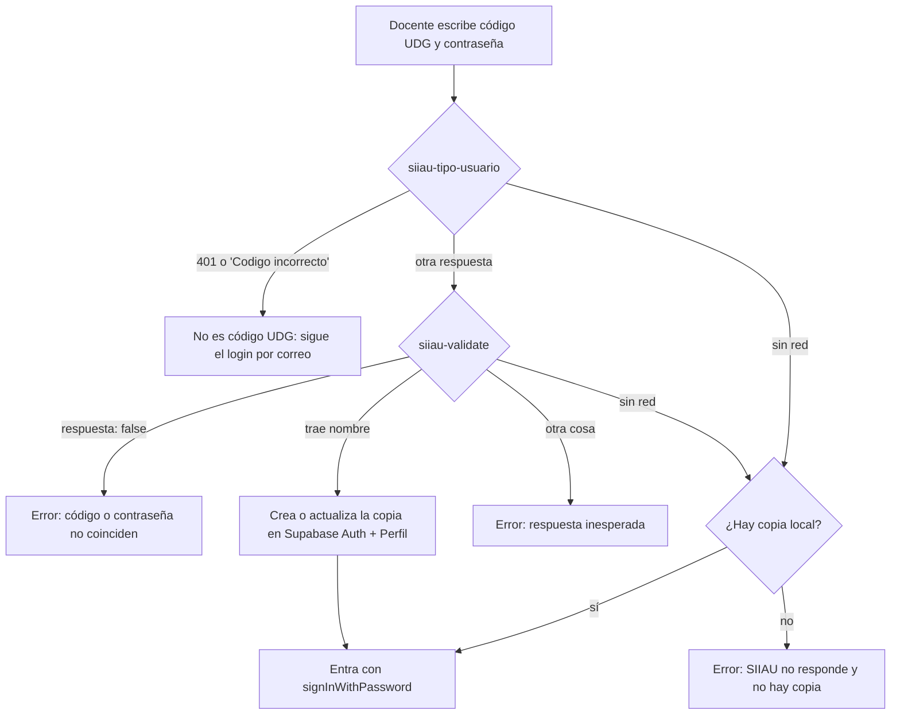

# Diseño: login con SIIAU

Estado: **propuesta, no activa.** El login vigente es correo + contraseña en Supabase Auth. Este documento describe cómo entraría un docente con su código UDG, y qué hay que decidir antes de activarlo.

Origen: PR #51 (@layon-king). La idea sigue el esquema de SIGI-LEIP: validar el código UDG contra SIIAU y, si SIIAU no responde, entrar con una copia local de la cuenta.

## Qué hay ya en el código

| Archivo | Contenido |
| --- | --- |
| `src/lib/auth/siiau.ts` | Tres funciones puras que interpretan las respuestas de SIIAU. Nada las llama todavía. |
| `src/lib/auth/siiau.test.ts` | Pruebas de esas tres funciones. |
| `.env.example` | Las dos URLs de SIIAU, comentadas. |

Las llamadas de red, la copia local y el cambio en `iniciarSesion` están solo en este documento (sección 4).

## 1. Flujo



| Respuesta de SIIAU | Función | Resultado |
| --- | --- | --- |
| `siiau-tipo-usuario` con `respuesta: "401 Unauthorized"` o `error: "Codigo incorrecto"` | `clasificarTipoUsuario` | `no-udg` |
| `siiau-tipo-usuario` con cualquier otra cosa | `clasificarTipoUsuario` | `reconocido` |
| `siiau-validate` con `respuesta: false` | `clasificarValidacion` | `rechazada` |
| `siiau-validate` con `nombre` no vacío | `clasificarValidacion` | `aceptada` |
| `siiau-validate` con otra cosa | `clasificarValidacion` | `inesperada` |
| Falla la red | `decisionSiConexionFalla` | `usar-copia-local` si hay copia, `sin-copia` si no |

Si el docente ya tiene un Perfil, la copia no le cambia el rol. Si su código está en `Profesor.codigo`, el Perfil queda ligado a ese profesor y usa su correo.

## 2. Decisiones pendientes antes de activarlo

Ninguna de estas está resuelta. Cada una bloquea la activación.

1. **Red.** Las URLs apuntan a `148.202.89.11`, que solo responde dentro de la red UDG. La app corre en Vercel, en internet pública, y no llega a esa IP. Opciones: que la UDG exponga SIIAU por internet, un intermediario dentro de la red UDG, o descartar SIIAU y quedarse con correo.
2. **Cifrado.** Las URLs son `http`, así que la contraseña UDG viajaría sin cifrar. Hace falta `https` o un canal cifrado.
3. **Copia de la contraseña UDG.** La copia local guarda la contraseña institucional en nuestro Supabase Auth (con hash). Replicar esa credencial en otro sistema necesita aprobación explícita (RNF-002). También implica que, si SIIAU cae, sigue sirviendo una contraseña UDG que el docente ya cambió.
4. **Docentes sin correo.** Supabase Auth exige correo. Si el código UDG no está en `Profesor`, no hay correo con el cual crear la copia. Hay que decidir si esa persona no entra o cómo se le asigna uno.
5. **Formulario.** Hoy el formulario valida que el campo sea un correo. Para aceptar código UDG hay que cambiar el formulario y la validación con zod de `iniciarSesion`.
6. **Llave de servicio.** Crear usuarios exige `SUPABASE_SECRET_KEY` en el servidor de la app. Hoy solo la usa `npm run crear-admin`.

## 3. Errores conocidos en el boceto

El código de la sección 4 es un boceto que nunca se ejecutó. Al retomarlo, hay que corregir esto:

- `copiarEnSupabase` llama a `createUser` en cada login correcto. Desde el segundo login falla porque el usuario ya existe. Debe buscar el usuario y, si existe, solo actualizar su contraseña (`updateUserById`).
- `entrarConSiiau` devuelve una variable `correo` que no está definida. Debe usar el valor que devuelve `copiarEnSupabase`.
- `existeCopiaLocal` solo revisa el Perfil ligado a `Profesor`. El comentario original también mencionaba usuarios creados con `user_metadata.codigo`.
- Las URLs deben leerse de `SIIAU_TIPO_USUARIO_URL` y `SIIAU_VALIDATE_URL`, no quedar fijas en el código.
- Falta probar el flujo completo con respuestas simuladas de SIIAU (`fetch` falso en Vitest).

## 4. Boceto del código

Tal como venía comentado en el PR #51, para que quien lo active no empiece de cero. Tiene los errores de la sección 3.

En `src/lib/auth/siiau.ts`:

```ts
const URL_TIPO_USUARIO = "http://148.202.89.11/d_alum/api/siiau-tipo-usuario";
const URL_VALIDATE = "http://148.202.89.11/d_alum/api/siiau-validate";

async function pedirSiiau(url: string, campos: Record<string, string>): Promise<unknown> {
  const respuesta = await fetch(url, {
    method: "POST",
    headers: { "Content-Type": "application/x-www-form-urlencoded" },
    body: new URLSearchParams(campos),
    signal: AbortSignal.timeout(5000),
  });
  return respuesta.json();
}

// Hay copia local si existe un Perfil ligado al Profesor con ese `codigo`,
// o un usuario de Supabase Auth creado en un login SIIAU anterior (user_metadata.codigo).
// El correo de la copia es Profesor.correo cuando el código ya está en el directorio.
// Supabase Auth exige correo: sin profesor no se inventa uno; hay que acordarlo al activar.

export async function entrarConSiiau(codigo: string, contrasena: string) {
  const hayCopiaLocal = await existeCopiaLocal(codigo);

  let tipo: unknown;
  try {
    tipo = await pedirSiiau(URL_TIPO_USUARIO, { codigo });
  } catch {
    return decisionSiConexionFalla(hayCopiaLocal) === "usar-copia-local"
      ? entrarConCopiaLocal(codigo, contrasena)
      : { estado: "sin-conexion-sin-copia" as const };
  }

  if (clasificarTipoUsuario(tipo) === "no-udg") return { estado: "no-udg" as const };

  let validacion: unknown;
  try {
    validacion = await pedirSiiau(URL_VALIDATE, { codigo, pass: contrasena });
  } catch {
    return decisionSiConexionFalla(hayCopiaLocal) === "usar-copia-local"
      ? entrarConCopiaLocal(codigo, contrasena)
      : { estado: "sin-conexion-sin-copia" as const };
  }

  const resultado = clasificarValidacion(validacion);
  if (resultado === "rechazada") return { estado: "credenciales-invalidas" as const };
  if (resultado !== "aceptada") return { estado: "respuesta-inesperada" as const };

  // 1) Primer login SIIAU correcto: copia en Supabase Auth + Perfil.
  //    Si Profesor.codigo coincide, el Perfil queda ligado (profesorId) y usa su correo.
  //    Si el Perfil ya existía, no se le cambia el rol; solo se actualiza la contraseña de la copia
  //    para que el siguiente fallo de red pueda usar signInWithPassword con esa misma clave.
  await copiarEnSupabase({ codigo, contrasena, nombre: validacion.nombre });
  return { estado: "copiado" as const, correo };
}

async function entrarConCopiaLocal(codigo: string, contrasena: string) {
  const copia = await prisma.profesor.findUnique({ where: { codigo }, include: { perfil: true } });
  const correo = copia?.perfil?.correo;
  if (!correo) return { estado: "sin-conexion-sin-copia" as const };
  return { estado: "usar-copia-local" as const, correo, contrasena };
}

async function existeCopiaLocal(codigo: string) {
  const profesor = await prisma.profesor.findUnique({ where: { codigo }, include: { perfil: true } });
  return Boolean(profesor?.perfil);
}

async function copiarEnSupabase(datos: { codigo: string; contrasena: string; nombre: string }) {
  // Requiere SUPABASE_SECRET_KEY en el servidor (hoy solo la usa `npm run crear-admin`, no la app).
  const profesor = await prisma.profesor.findUnique({ where: { codigo: datos.codigo } });
  const correo = profesor?.correo;
  if (!correo) throw new Error("Sin correo institucional no hay copia en Auth.");
  const admin = createClient(process.env.NEXT_PUBLIC_SUPABASE_URL!, process.env.SUPABASE_SECRET_KEY!, {
    auth: { persistSession: false, autoRefreshToken: false },
  });
  const creado = await admin.auth.admin.createUser({
    email: correo,
    password: datos.contrasena,
    email_confirm: true,
    user_metadata: { codigo: datos.codigo, nombre: datos.nombre },
  });
  const userId = creado.data.user?.id;
  if (!userId) throw creado.error ?? new Error("No se pudo crear la copia en Auth.");
  await prisma.perfil.upsert({
    where: { id: userId },
    update: { profesorId: profesor?.id },
    create: { id: userId, correo, rol: "DOCENTE", profesorId: profesor?.id },
  });
  return correo;
}
```

En `src/app/login/actions.ts`, antes de `signInWithPassword` (el formulario también envía `codigo`):

```ts
const codigo = String(formData.get("codigo") ?? "");
const siiau = await entrarConSiiau(codigo, datos.data.contrasena);
if (siiau.estado === "no-udg") {
  // No es código SIIAU: sigue el login por correo de abajo.
} else if (siiau.estado === "copiado" || siiau.estado === "usar-copia-local") {
  const { error: errorCopia } = await supabase.auth.signInWithPassword({
    email: siiau.correo,
    password: datos.data.contrasena,
  });
  if (errorCopia) return { error: "No se pudo entrar con la copia local.", correo };
  redirect("/");
} else if (siiau.estado === "credenciales-invalidas") {
  return { error: "El código UDG o la contraseña no coinciden.", correo };
} else if (siiau.estado === "sin-conexion-sin-copia") {
  return { error: "SIIAU no responde y esta cuenta aún no tiene copia local.", correo };
} else {
  return { error: "SIIAU no devolvió una respuesta utilizable.", correo };
}
```
